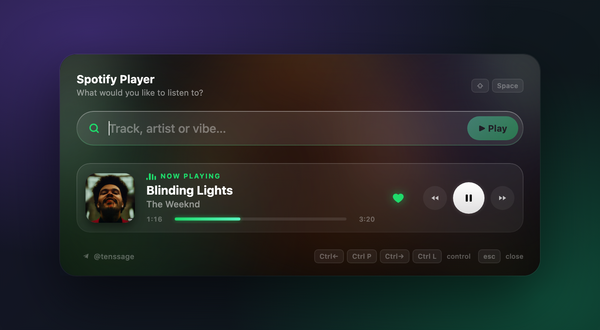
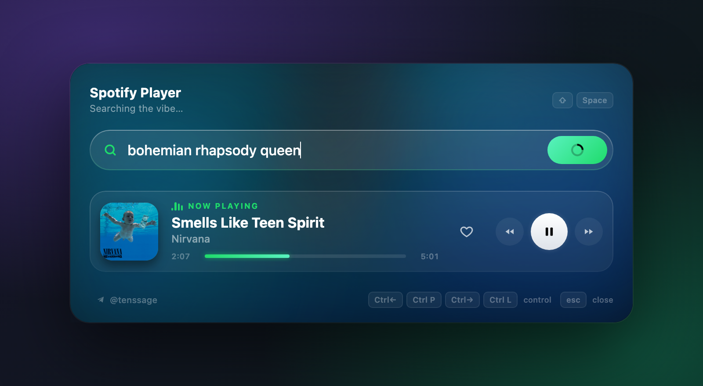
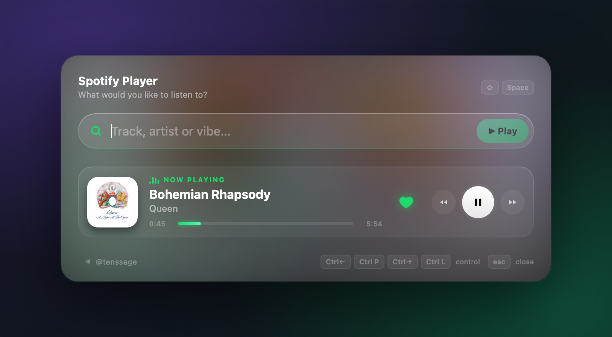

# 🎧 Spotify Player

A tiny, fast Spotify launcher for **macOS** and **Windows**. Press **Shift+Space** from anywhere, type an artist or a song, hit Enter, and it plays.

<p align="center">
  
</p>

<p align="center">
  
  
</p>

## Features

- ⚡ **Shift+Space** opens the search window from any app.
- 🧠 **Smart search.** "Nirvana" plays the artist, "smells like teen spirit" plays the song, "nirvana come as you are" plays that exact track. Cyrillic spellings work too: "Скриптонит" finds Skryptonite.
- 🎵 **Now playing**: album art, smooth progress bar, click to seek.
- ⏮ ⏯ ⏭ and ❤️ **like** right from the window, with keyboard shortcuts.
- 🌈 **Living background** made from the blurred album art, plus smooth animations.
- 🚀 If Spotify is closed, the player opens it for you.

| | macOS | Windows |
|---|---|---|
| Show / hide | ⇧ Space | Shift+Space |
| Play / pause | ⌘P | Ctrl+P |
| Previous / next | ⌘← / ⌘→ | Ctrl+← / Ctrl+→ |
| Like | ⌘L | Ctrl+L |
| Close | Esc | Esc |

> Controlling playback through the Spotify Web API requires **Spotify Premium**.

## Install

Download a ready-made build from **[Releases](../../releases/latest)**:

- **macOS** (Apple Silicon, macOS 26+): `SpotifyPlayer-macOS.zip`. Unzip it and drag the app to Applications.
  The app isn't notarized, so on first launch **right-click it → Open → Open**,
  or run `xattr -cr "/Applications/spotifydj.app"` in Terminal.
- **Windows 10/11**: `SpotifyPlayer-Windows.zip`. Unzip it and run `SpotifyPlayer.exe`.
  If you see "Windows protected your PC", click **More info → Run anyway**.

### First launch: Spotify keys

The player talks to Spotify through your own (free) Spotify developer app. It takes a couple of minutes:

1. Open https://developer.spotify.com/dashboard and click **Create app**.
2. Any name works. Set the **Redirect URI** to `http://127.0.0.1:8888/callback` and tick **Web API**.
3. Launch the player. A setup page opens in your browser: paste your **Client ID** and **Client Secret**, then log in to Spotify.

Your keys and login stay on your computer and are only ever sent to Spotify.

## How it works

```
┌──────────────┐   HTTP 127.0.0.1:8888   ┌──────────────┐   Web API   ┌─────────┐
│ player window│ ──────────────────────▶ │  server.py   │ ──────────▶ │ Spotify │
│ Swift / HTML │ ◀────────────────────── │ (Flask)      │ ◀────────── │         │
└──────────────┘                         └──────────────┘             └─────────┘
```

- `server/`: the shared local Python server (search, playback, likes, OAuth login).
- `macos/`: a SwiftUI menu bar app; the server is built with PyInstaller and bundled inside the `.app`.
- `windows/`: a pywebview window (HTML/CSS), a tray icon and a global hotkey.

## Build from source

**macOS** (Xcode 27+, Python 3.11+):
```bash
open macos/spotifydj.xcodeproj
```
Press Run. On the first build Xcode builds the server automatically (`server/build_mac.sh`).

**Windows** (Python 3.11+): run `windows\build.bat`. The `.exe` ends up in `windows\dist\SpotifyPlayer`.
See [windows/README.md](windows/README.md) for details.

Release builds for Windows are made by GitHub Actions ([windows-release.yml](.github/workflows/windows-release.yml)): when a release is published, `SpotifyPlayer-Windows.zip` is attached to it automatically.

## Author

Made by [@tenssage](https://t.me/tenssage). Not affiliated with Spotify AB. "Spotify" is a trademark of Spotify AB.

License: [MIT](LICENSE).
